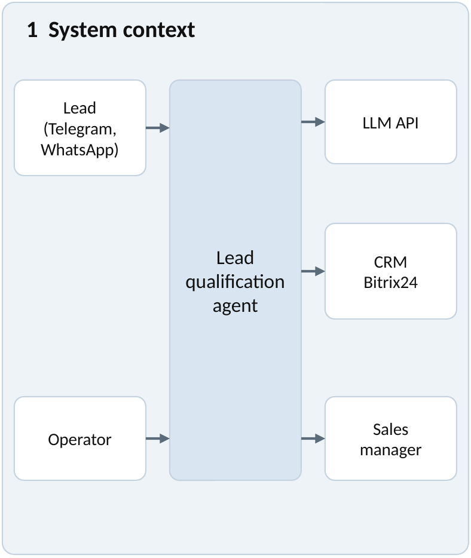
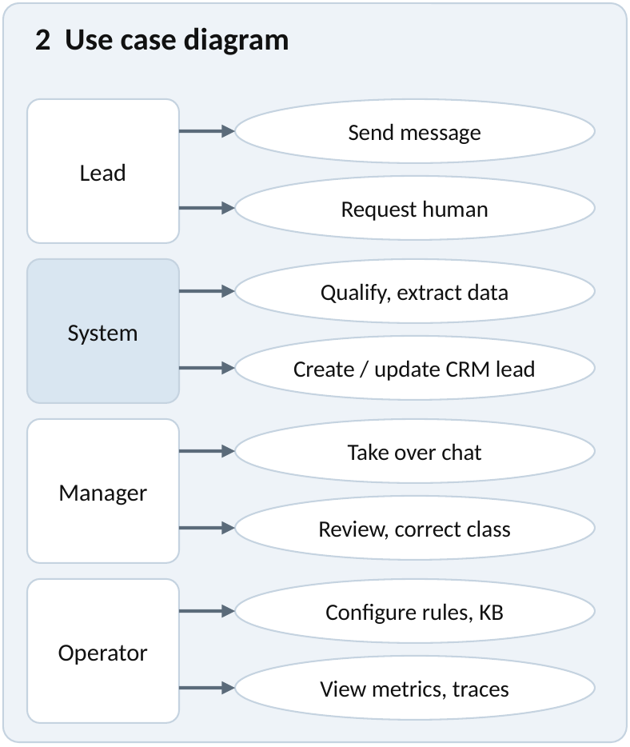
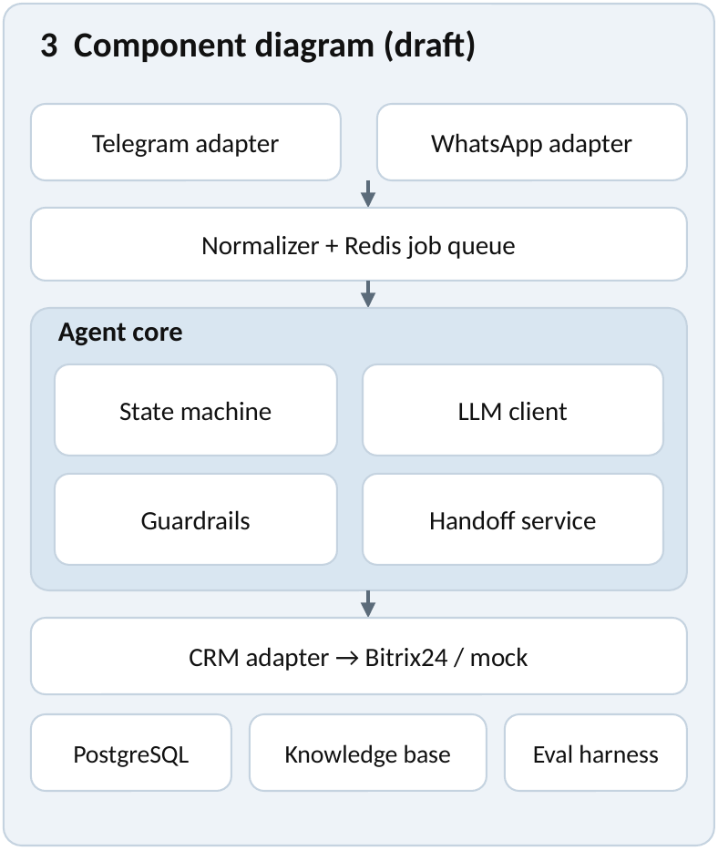

# 7. Architecture and diagrams

## 7.1 Architectural description

The system is a server-side agent. A message from Telegram or WhatsApp arrives through a webhook; the channel adapter normalizes it and a job is placed in a Redis queue so that the webhook can answer quickly. A worker loads the dialogue state and history from PostgreSQL, builds the prompt (qualification script, knowledge-base snippets, history) and calls the LLM through an interface. The model proposes the next message and the extracted fields; code, not the model, decides state transitions. Guardrails validate the output against the lead schema and the policy (no invented prices, tool whitelist). When the dialogue is complete or a handoff trigger fires, the CRM adapter creates or updates the lead in Bitrix24 and the manager is notified. Every decision is stored as a trace for evaluation.

## 7.2 System context diagram

Editable source: [system-context.mmd](https://github.com/Wolfenste1n/diploma-Madiyar/blob/prob-period-1/diagrams/system-context.mmd)

## 7.3 Use case diagram

Editable source: [use-case.mmd](https://github.com/Wolfenste1n/diploma-Madiyar/blob/prob-period-1/diagrams/use-case.mmd)

## 7.4 Component diagram (draft)

Editable source: [component.mmd](https://github.com/Wolfenste1n/diploma-Madiyar/blob/prob-period-1/diagrams/component.mmd)

## 7.5 Key design decisions

1. **Explicit state machine around the LLM.** States: greeting, collecting, confirming, done, plus handoff. The model suggests, code decides (literature source 5).
2. **Typed lead schema with validation.** Invalid output is retried once, then flagged for a human.
3. **Tool whitelist.** The model can call only the CRM upsert, a knowledge-base search and a handoff request; customer text is untrusted data (source 9, NFR-05).
4. **Adapter interfaces** for channel, LLM and CRM (NFR-08).
5. **Asynchronous processing** with a queue (NFR-01, NFR-02).
6. **Idempotency.** The lead key is channel plus chat id; message ids are deduplicated.

## 7.6 Alignment of requirements, components, data and scenarios

<!-- widths: 24,30,26,20 -->
| Requirement | Component | Data | Scenario (use case) |
|---|---|---|---|
| FR-01, FR-02 | Telegram and WhatsApp adapters, normalizer, queue | Message | Send message |
| FR-03 | Conversation manager (state machine) | Dialogue state, history | Send message |
| FR-04, FR-05 | Prompt builder, LLM client, guardrails | Lead schema | Qualify and extract lead data |
| FR-06 | Guardrails and classification step | Lead class and rationale | Qualify and extract lead data |
| FR-07 | CRM adapter (Bitrix24, mock) | Lead card | Create or update CRM lead |
| FR-08 | Handoff service | Handoff reason | Request human; take over chat |
| FR-09 | Knowledge base | Knowledge-base items | Send message |
| FR-10 | Configuration loader | Rules, fields | Configure rules and knowledge base |
| FR-11 | Trace store, evaluation harness | Traces, metrics | View metrics and traces |

## 7.7 Editable sources and exports

Diagram sources are Mermaid text files in [diagrams/](https://github.com/Wolfenste1n/diploma-Madiyar/tree/prob-period-1/diagrams); PNG exports used in this report are in [diagrams/png/](https://github.com/Wolfenste1n/diploma-Madiyar/tree/prob-period-1/diagrams/png).
