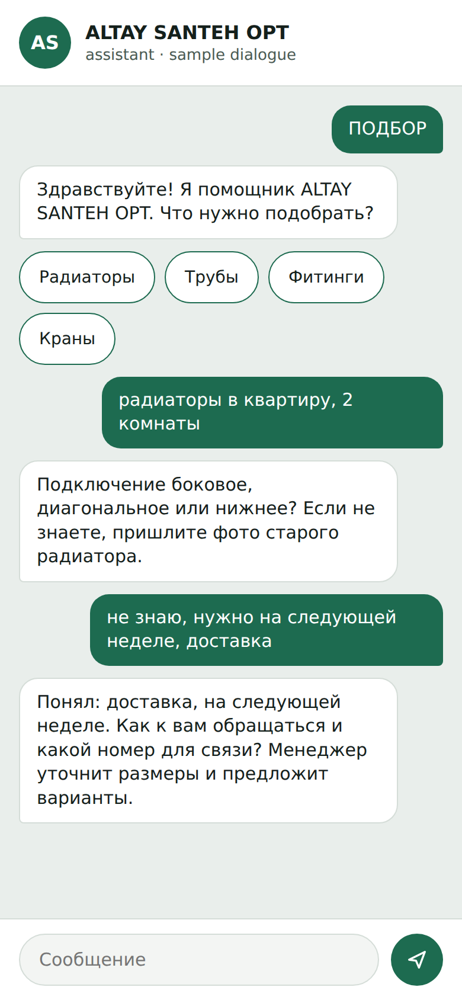
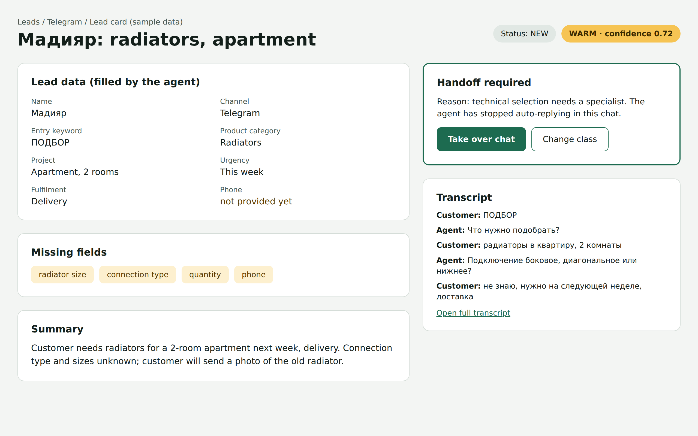
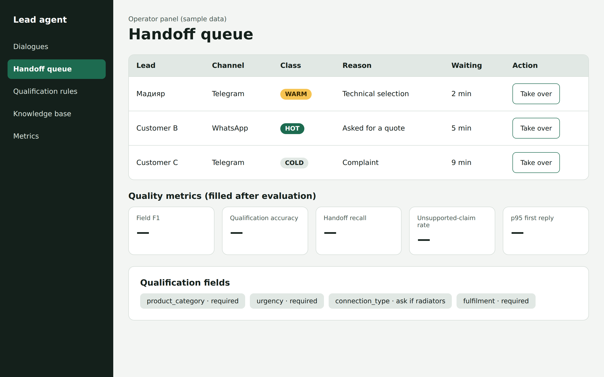

# 8. UX / prototype

## 8.1 What is prototyped

The project has no end-user application of its own. People work in tools they already use: customers in a messenger, managers in the CRM, the operator in a small panel. The prototype therefore shows three key screens and the data contract between the agent and the CRM. All data on the mockups is synthetic (no real customers, no real prices); the metric tiles in the operator panel stay empty until the evaluation produces values.

## 8.2 Mockups of key scenarios







## 8.3 Key scenario

| Step | Actor | What happens |
|---|---|---|
| 1 | Customer | Writes the keyword ПОДБОР in the messenger |
| 2 | Agent | Greets and offers the product groups (radiators, pipes, fittings, taps) |
| 3 | Customer | Answers in free text: radiators for a 2-room apartment |
| 4 | Agent | Asks only for missing fields (connection type; photo of the old radiator) |
| 5 | Customer | Gives the timing (next week) and delivery |
| 6 | Agent | Asks for name and phone, then hands over because a specialist is needed |
| 7 | System | Creates the lead card in the CRM with class WARM, missing fields and summary |
| 8 | Manager | Sees the notification, opens the chat and takes over |

## 8.4 Data contract (output of the agent)

```
{
  "intent": "consultation",
  "product_category": "radiators",
  "project_type": "apartment",
  "urgency": "this_week",
  "fulfilment": "delivery",
  "qualification": "WARM",
  "confidence": 0.72,
  "missing_fields": ["size", "connection_type", "phone"],
  "handoff_required": true,
  "handoff_reason": "technical selection needs a specialist"
}
```

## 8.5 How users and external systems interact

Customers use the messenger they already have; managers work in the CRM; the operator uses the panel; external systems connect through webhooks (Telegram, WhatsApp) and the REST API (Bitrix24, LLM provider).

## 8.6 Prototype files

Mockup images: [prototype/](https://github.com/Wolfenste1n/diploma-Madiyar/tree/prob-period-1/prototype)
